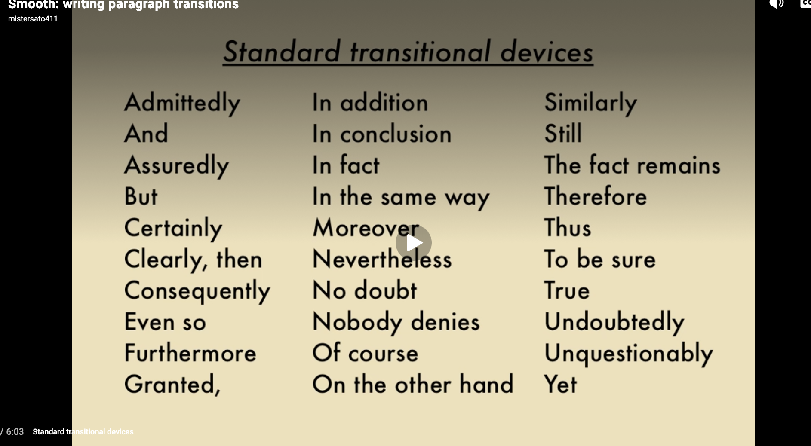

According to them there are several keys to college success and why you should take a degree. 

Establish general goals to help narrow down an academic path.
- According to them 
1. Folks with higher levels of education tend to be overall happier, well rounded people.
2. This is in part to the income level which tends to be higher and as they have studied they tend to be able to pick out more of the jobs they want. 
3. They also tend to be ones who stick around during layoffs compared to folks without a degree
4. It was suggested that by benjiman Franklin if you empty your wallet into your mind no one can steal it

Identify effective organizational skills for studying.
1. By creating a clear, clean env that you study in you are able to focus better
2. Set the ideal tempature where you are not too hot and not too cold 
3. calm music or none at all
4. Set a plan and stick to it 
5. Set realistic goals for what you want to do 

Identify the value and principle of time management and define strategies that work for you.
1. When is the best time for you to study and plan around it
2. scheudle time to get all the things you want to done. 
3. set clear starting and stopping times
4. Manage your time effectivly - to start, set timers when you do this
5. for task management, I tend to be a combo of things where I like to orginize things by level of importance and will also sometimes multi task but i know that if I distill down to one or two tasks, it goes better 
6. They also suggest getting a planner 

Overall focusing your long term goalso you know what you'd like to do should help you get there. 

There is an opportity cost, if you take something on or work towards a goal, there is usually a tradeoff. You lose out on the best possible alternative

Habits:
1. Set what you can control
2. Be sure to plan accordingly 
3. be sure to plan breaks 

to remember the material talk through the study tool you built for remembering things and how this differes for how I approch free form writing vs multi choice

Different Styles of learning: 
Overview: there are different learning styles. 
1. Visual 
    - They tend to like graphs, charts, and colors
2. Auditory
    - Some people love verbal learning

3. kinesthetic learners
    - These folks do better wtih small blocks of time
    - They like trying it as they go and trying to figure it out
    - having something to play with or look at as you go will help you

4. reading and writing learning
    - these ones like reading and writing and 

My style is a combo of visual + Audio,  but also note that as learning styles are a preference, you can still learn with all of them its just a bit harder and you will need to adjust accordingly 

Attitues towards learning will go along way in ensuring someone learns the material or not, can you make it fun for yourself 

In Blooms Taxonomy of learning 

You first must be able to take in the material, understand it and apply it, and then start to anylize and decide for yourself if this makes to move on from. This also implies that the learning that you have is cummulative and must build on itself

The origional framework was as follows:
Knowledge
Comprehension
Application
Analysis
Synthesis
Evaluation

This then lead to a revised taxomomy 
1. Remembering: Recall or retrieve previous learned information.
2. Understanding: Comprehending the meaning, translation, interpolation, and interpretation of instructions and problems. State a problem in one's own words.
3. Applying: Use a concept in a new situation or unprompted use of an abstraction. Applies what was learned in the classroom into novel situations in the work place.
4. Analyzing: Separates material or concepts into component parts so that its organizational structure may be understood. Distinguishes between facts and inferences.
5. Evaluating: Make judgments about the value of ideas or materials.
6. Creating: Builds a structure or pattern from diverse elements. Put parts together to form a whole, with emphasis on creating a new meaning or structure.

There are many different ideas that you can build from, and being able to connect those divese modes of thought is a skill

Studying notes 
1. Overall rewview your notes, and be sure to study in your learning style
2. Atomic habits of when you are trying to build a habit, build off an existing one so you are able to build in tandem

Critical Thinking: 
1. A good reason for something is directly tied to how probable the outcome is
2. Bad reasons would be if something is not probable to be the case. 

What is an argument?  An argument is a set of statements called Premises. And premises comprise of reasons to believe something is true. 

Argument types: 
There are different argument types (Critical thinking ways of presenting information to show you have logic behind the statement) when building an argument and working with critical thinking skills 

1. Deductive: When the truth of the premises guarantees the truth of the conclusion. 
Example being 
Premmise 1: Monty is in Tokyo, 
Premise 2: It is impossible to get here from there in an afternoon

If both premises are true, then the fact must be true. 

2. Ampliative (amp-plee-a-tive): The truth of these arguements make this probable but not 100% fact. 
Even if the premise are true, that doesn't mean that the conclusion is true. 
Premise 1: Monty is really shy
Premise 2: Monty rarely goes to parties

The conclusion is possible to be true but not guarenteed . 

The Argument for Critical thinking: 
1. Self defencse There are many different points of view that are constantly vieing for your attention. you should be able to recognize and defend yourself against these and should be able to form your own thoughts, values and opinions. 
    - Each of these entities (goverments, ad companies, instituations, anything) want you to adhear to a specific view point as this gets them money power influence etc. By adhearing to their values you push that agendea along
    - Many different companies also are competing against each other. Rather than one or the other, is there also other points of views to consider that we should think through.
    - I feel that over time people also tend to lose the ability to think for themseleves. It is disouraged in the work place and tends towards group think. This can lead to fragmented entities which can become fragile. When there is only one mode of thinking, there is the same strengths and same weaknesses. 
2. To do this you must build the muscle of critical thinking. If you want to become an independent thinker, you should be able to analyze and acknologing that we are in an envorement of this. 

If you view this as self defense and learn about the different arguement types that are out there, you can "immunuize" your self to them as you can start to see them. Seeing them can help you to understand and gaurd agasint them but also to use them if needed. 

The overall goal is ownership and justification of our own views, values and beleifes and why we hold them

Critical thinking / philosophy: Philosophy is the systematic and critical study of fundamental questions that arise in everyday life and through other disciplines. Its aim is not just to collect facts, but to help people think clearly by analyzing and assessing arguments.Through critical thinking you should be able to get a clear and deep grasp on why you believe something.

Critical thinking — in being responsive to variable subject matter, issues, and purposes — is incorporated in a family of interwoven modes of thinking, among them: scientific thinking, mathematical thinking, historical thinking, anthropological thinking, economic thinking, moral thinking, and philosophical thinking.

Critical thinking depends on why a person is doing it. When it’s driven by self-interest, people use clever reasoning to protect or advance their own goals or their group’s. This kind of thinking is often flawed, even when it works well in practice. When it’s driven by fairness and honesty, it’s usually stronger and more sound, though people used to the selfish kind may dismiss it as unrealistic.

Media Literacy is also important as people are constantly being bombarded with messages through media. There is encoded messages (what someone or soemthing is trying to convey or convence on) and what you as the reciver decode (what you get based on your worldviews, your understanding of the messaging etc). Being able to critcally think through these sources and view them with a critical eye allows you to be able to get a grasp as to if you agree or not with the material without just asorbing the message and moving on 

Sources and Credible Sources: 
1. Author: The author has expertiese in the field they are writing in or in the media you are consuming. 
2. View: What is the point of view that it has? is there bias baked in? What type of world view does it present?
3. Date: Is it still in date? 

Peer Reviewd Publications 
1. this means that a panel of scholars has revied and evaluated the work for quality, accuracy, and credibility before it was published. 
when looking for papers to source stuff for your reserach, you will want to find things that are credible and will work for what you are hoping to do but ensure that they are from a credible source. You will need to eval author, view, and date and find peer reviewed journals if possible . You need to assess if it is correct for your work as well

The first motion pictures were shown in the 1890's and it has only grown from there. 

Media literacy there is different forms of media literacry, One is known as protectionism. This form of protection is full censorsiship and removal of said media as a form of protect. They tended to beleive that that people were in grave danger from these messages. A few forms of this would be cultural defensiveness where certian types of media are said to have less cultural value than others. "they don't make them like they use to is a good example of this one"  There is also politcal defensisvnes where those folks beleive that people must be protected from false beliefs and ideologies. and then there is moral defensiveness where the individual belelives that the bigeest concern is the effects of sex, violence and consumerisum is of the biggest concern

"Cultural defenseism in media literacy refers to the idea that individuals should be educated to critically analyze media content through the lens of their own cultural backgrounds. This approach emphasizes understanding how cultural contexts influence the interpretation of media messages and promotes skills to navigate and evaluate media effectively. Cultural literacy enhances the ability to decode media messages relevant to one's cultural identity." 

Moral panic when this is a preceved threat to the social norm. This tends to have people then act on the precieved threats that are often based on stereotypes, racism or sexism.

We shape our tools, and our tools then shape us

Writing:
There are different forms of paragraph transitions
1. Standard transitional devices 
2. paragraph "links" 

An example of standard tranistional devices would be as follows

a link on the other hand can be a "word link" or an idea link
A word link would take one word from the first paragraph as an idea and tie it into the second one to link the paragraphs together where and idea link focuses on refereing that idea "that" etc. 

What academic writing is: 
1. Academic writing is a formal, structured and evidence based style of communication used in college and scholarly work